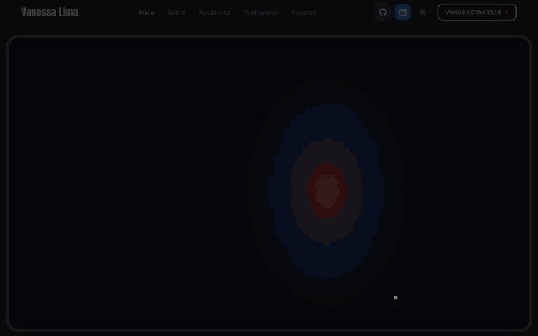
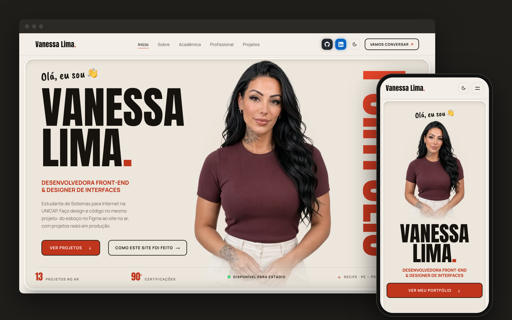
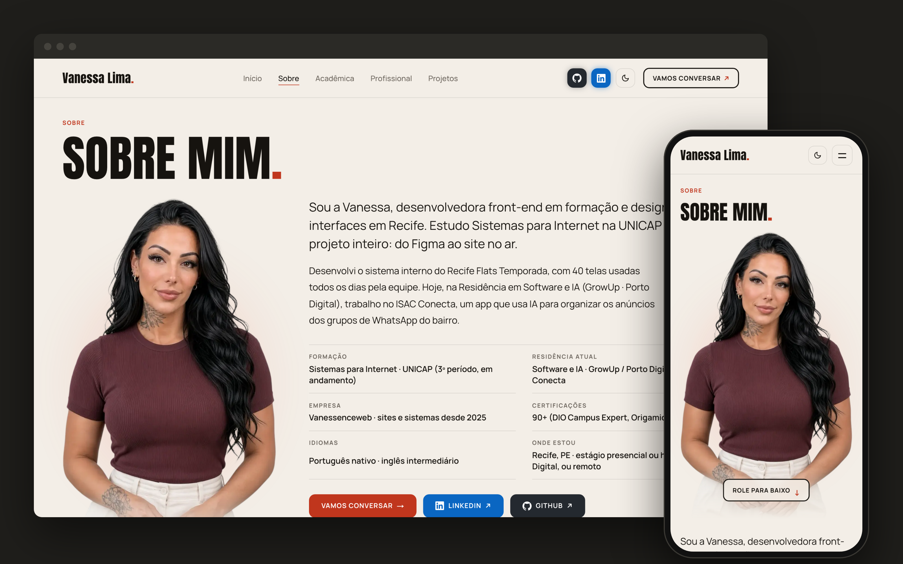
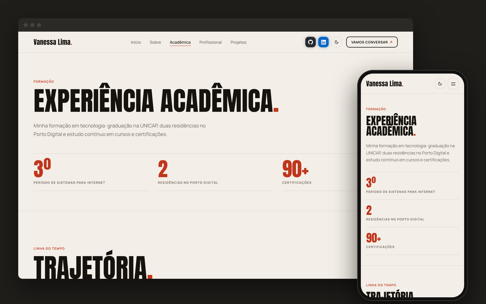
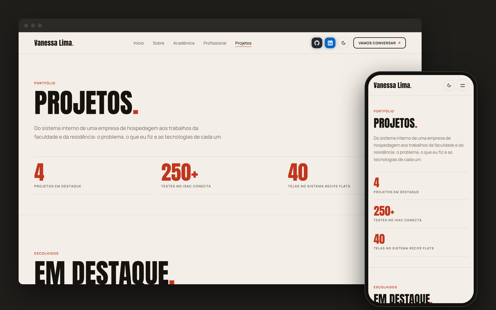
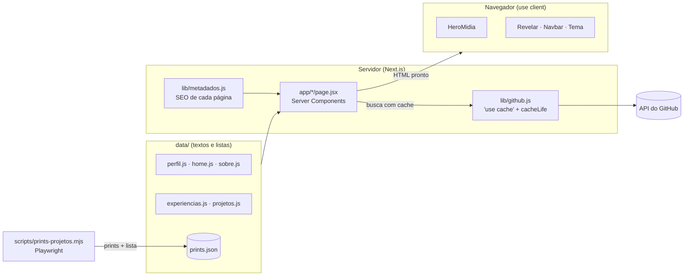

<div align="center">

# Portfólio — Vanessa Lima

**Desenvolvedora front-end em formação & designer de interfaces · Recife, PE**

Portfólio profissional feito com Next.js e React: do esboço no Figma ao site no ar, com testes, acessibilidade e SEO desde o primeiro dia.

[](https://nextjs.org/)
[](https://react.dev/)
[](https://developer.mozilla.org/pt-BR/docs/Web/JavaScript)
[](https://github.com/css-modules/css-modules)
[](#-testes)
[](https://playwright.dev/)
[](https://eslint.org/)
[](https://prettier.io/)
[](#-qualidade-acessibilidade-seo-e-segurança)
[](https://portfolio-vanessa-lima.vercel.app)

<br />

<a href="https://portfolio-vanessa-lima.vercel.app">
  
</a>

<br />

🔗 **[Ver o site no ar](https://portfolio-vanessa-lima.vercel.app)** · [GitHub](https://github.com/VANESSENCEWEB) · [LinkedIn](https://www.linkedin.com/in/vanessa-lima-dev/)

</div>

---

## 📑 Sumário

- [Sobre o projeto](#-sobre-o-projeto)
- [Telas](#-telas)
- [Funcionalidades](#-funcionalidades)
- [Tecnologias](#️-tecnologias)
- [Arquitetura](#️-arquitetura)
- [Decisões técnicas](#-decisões-técnicas)
- [Design system](#-design-system)
- [Estrutura de pastas](#-estrutura-de-pastas)
- [Como rodar](#-como-rodar)
- [Scripts](#-scripts)
- [Testes](#-testes)
- [Qualidade, acessibilidade, SEO e segurança](#-qualidade-acessibilidade-seo-e-segurança)
- [Limitações conhecidas](#️-limitações-conhecidas)
- [O que este projeto demonstra](#-o-que-este-projeto-demonstra)
- [Deploy](#-deploy)
- [Roadmap](#️-roadmap)
- [Como a IA foi usada](#-como-a-ia-foi-usada)
- [Sobre a autora](#-sobre-a-autora)
- [Créditos](#-créditos)
- [Licença](#-licença)

---

## 📖 Sobre o projeto

Este é o meu portfólio: o lugar onde reúno quem eu sou, minha formação, minha experiência e os projetos que desenvolvi. Construí com **Next.js e React**, do esboço no Figma ao site no ar, pensando em **recrutadores de estágio e professores**.

Além de mostrar os projetos, o site mostra **como ele foi feito**:

- a página **Sobre** lista cada tecnologia usada e o papel dela no site;
- as **decisões técnicas**, com o porquê de cada uma, estão em [`docs/DECISOES.md`](docs/DECISOES.md);
- o **diário** em [`docs/DIARIO.md`](docs/DIARIO.md) tem um print e o que aprendi em cada etapa;
- **298 testes automatizados** conferem que tudo continua funcionando a cada mudança.

| Item        | Detalhe                                                                        |
| ----------- | ------------------------------------------------------------------------------ |
| **Público** | Recrutadores de estágio e professores                                          |
| **Páginas** | Início · Sobre · Experiência Acadêmica · Experiência Profissional · Projetos   |
| **Status**  | ✅ v1.0.0 no ar · melhorias contínuas (hero nova, página Sobre mais enxuta)    |
| **No ar**   | [portfolio-vanessa-lima.vercel.app](https://portfolio-vanessa-lima.vercel.app) |

---

## 📸 Telas

A imagem abaixo acompanha o tema do seu GitHub: no modo escuro aparece a Hero com o vídeo; no modo claro, a versão com a foto.

<div align="center">
<picture>
  <source media="(prefers-color-scheme: dark)" srcset="docs/progresso/2026-11-20-etapa-09-inicio-escuro.png" />
  <source media="(prefers-color-scheme: light)" srcset="docs/progresso/2026-11-20-etapa-09-inicio-claro.png" />
  
</picture>
</div>

<table>
  <tr>
    <td align="center" width="33%">
      
      <br /><sub><b>Sobre</b> · bio e todas as tecnologias do app</sub>
    </td>
    <td align="center" width="33%">
      
      <br /><sub><b>Experiências</b> · linha do tempo e certificações</sub>
    </td>
    <td align="center" width="33%">
      
      <br /><sub><b>Projetos</b> · destaques e API do GitHub</sub>
    </td>
  </tr>
</table>

---

## ✨ Funcionalidades

**Em todas as páginas**

- Navbar fixa com efeito vidro, link da página atual e ícones do GitHub e LinkedIn
- Menu hambúrguer acessível no celular/tablet (fecha com `Esc` e ao trocar de página)
- Tema **claro/escuro**: segue o sistema, lembra a escolha e não "pisca" ao abrir
- Rodapé com contato, páginas e redes
- **Tags coloridas por área** de tecnologia (inspiradas na Origamid), com brilho no hover
- SEO completo: canonical, Open Graph e Twitter com imagem em **todas** as páginas, `sitemap.xml`, `robots.txt` e JSON-LD

**Por página**

| Página           | O que tem                                                                                                                                                                                                                                                  |
| ---------------- | ---------------------------------------------------------------------------------------------------------------------------------------------------------------------------------------------------------------------------------------------------------- |
| **Início**       | Hero numa tela só, numa moldura com relevo: nome que **entra letra por letra**, mão acenando, foto (tema claro) ou **vídeo de fundo transparente** (tema escuro) no centro, "PORTFÓLIO" na vertical e a seção seguinte **subindo por cima como uma folha** |
| **Sobre**        | Bio, foto, habilidades, **todas as tecnologias e módulos usados neste app** (agrupadas por família, com o papel de cada uma em uma linha e a versão lida do `package.json`) e "como este site foi feito"                                                   |
| **Acadêmica**    | Linha do tempo com a graduação e **duas residências** no Porto Digital, e certificações em destaque                                                                                                                                                        |
| **Profissional** | Linha do tempo de trabalho e sites feitos para clientes                                                                                                                                                                                                    |
| **Projetos**     | Destaques com **mockup de computador + celular** (prints gerados por script) e lista automática dos repositórios pela **API do GitHub**, com cache                                                                                                         |
| **404**          | Página personalizada com caminhos de volta                                                                                                                                                                                                                 |

---

## 🛠️ Tecnologias

| Tecnologia                                                                      | Versão | Para quê                                                           |
| ------------------------------------------------------------------------------- | ------ | ------------------------------------------------------------------ |
| [Next.js](https://nextjs.org/) (App Router, Cache Components)                   | 16     | Rotas por pasta, Server Components, metadata/SEO, fontes e imagens |
| [React](https://react.dev/)                                                     | 19     | Componentes e interatividade                                       |
| JavaScript                                                                      | ES2023 | Linguagem do projeto (TypeScript fica para a próxima versão)       |
| CSS Modules + variáveis CSS                                                     | —      | Estilos isolados por componente; tema trocando variáveis           |
| `next/font/google`                                                              | —      | Anton, Caveat Brush e Manrope servidas pelo próprio site           |
| `next/image`                                                                    | —      | Fotos e prints em AVIF/WebP no tamanho certo para cada tela        |
| `next/og`                                                                       | —      | Gera a imagem de compartilhamento a partir de JSX                  |
| `"use cache"` + `cacheLife`                                                     | —      | Guarda a lista do GitHub por algumas horas                         |
| [API REST do GitHub](https://docs.github.com/rest)                              | —      | Repositórios públicos na página Projetos                           |
| `<video>` WebM com canal alfa                                                   | —      | Vídeo da Hero com fundo transparente (WebP animado no Safari)      |
| [Vitest](https://vitest.dev/) + [Testing Library](https://testing-library.com/) | 5 / 16 | Testes de componentes, dados, SEO e funções                        |
| [ESLint](https://eslint.org/) + [Prettier](https://prettier.io/)                | 9 / 3  | Qualidade e padronização do código                                 |
| [Playwright](https://playwright.dev/)                                           | 1      | Prints do diário (`mockup`) e dos cartões de projeto (`prints`)    |
| [Vercel](https://vercel.com/)                                                   | —      | Hospedagem com deploy automático a cada push                       |

> A lista completa, com o papel de cada pacote e módulo, está na própria [página Sobre](https://portfolio-vanessa-lima.vercel.app/sobre) — e um teste falha se algum pacote novo ficar sem explicação.

---

## 🏗️ Arquitetura

Todo o **conteúdo** fica em `data/`; os **componentes** só desenham; as **páginas** juntam os dois. O que precisa do navegador (vídeo, menu, tema) fica em componentes cliente pequenos — o resto chega pronto em HTML.



---

## 💡 Decisões técnicas

As 18 primeiras decisões, com contexto e porquê, estão em [`docs/DECISOES.md`](docs/DECISOES.md). As mais importantes:

<details>
<summary><b>1. Conteúdo em <code>data/</code>, e dado não confirmado vale <code>PREENCHER</code></b></summary>

<br />

Os textos ficam em arquivos de dados (`data/sobre.js`, `data/experiencias.js`...), separados do layout. Quando uma data ou um cargo ainda não foi confirmado, o campo vale `PREENCHER`: o site esconde o campo, o `npm run dev` mostra um aviso ✏️ e o `npm test` lista tudo o que falta. Nada é inventado para "completar" a página.

</details>

<details>
<summary><b>2. API do GitHub no servidor, com cache e função "pura" separada</b></summary>

<br />

A busca acontece num Server Component com `"use cache"` + `cacheLife("hours")`: a API é chamada poucas vezes (o limite sem token é de 60 pedidos por hora) e a página abre rápido. O filtro (`lib/repositorios.js`) é uma função pura, testada sem internet: tira forks, arquivados, vazios e repositórios sem descrição. Se a API falhar, a página mostra um link para o perfil em vez de quebrar.

</details>

<details>
<summary><b>3. Mockup em CSS e prints gerados por script</b></summary>

<br />

`npm run prints` abre cada site num navegador invisível (Playwright) e tira dois prints, computador e celular — inclusive esperando a hospedagem gratuita "acordar". A moldura (janela + celular) é CSS, não imagem: se adapta ao cartão e ao tema, e o `next/image` entrega os prints em formato leve.

</details>

<details>
<summary><b>4. Vídeo com fundo transparente, plano B no Safari e botão de pausar</b></summary>

<br />

O vídeo da Hero é WebM com canal alfa. O Safari (e todo navegador do iPhone) ignora a transparência e pintaria o fundo de preto, então recebe um WebP animado — a escolha fica em `lib/midia.js`, testada com os agentes de cada navegador. Animação com mais de 5 s precisa de um jeito de parar (WCAG 2.2.2): há um botão de pausa, e quem pediu "reduzir movimento" vê a imagem parada. O vídeo só é baixado no tema escuro.

</details>

<details>
<summary><b>5. Metadados completos por página</b></summary>

<br />

O Next junta os metadados do layout e da página de forma **rasa**: quem escreve `openGraph` na página perde a imagem e o tipo definidos no layout. `lib/metadados.js` monta tudo de uma vez (canonical, Open Graph e Twitter com imagem), e um teste confere as 5 páginas.

</details>

<details>
<summary><b>6. Contraste medido, não "no olho"</b></summary>

<br />

O vermelho da marca (`#e8462b`) dava 3,4:1 sobre o creme do tema claro — abaixo do mínimo de 4,5:1 para texto pequeno. No tema claro ele virou `#c0361d`, e os fundos de botão com texto branco ganharam a variável `--cor-botao`. Resultado: acessibilidade 100 no Lighthouse nas 5 páginas, nos dois temas.

</details>

---

## 🎨 Design system

Componentes base em `components/ui/`, todos Server Components (HTML pronto, sem JavaScript extra no navegador):

| Componente    | Para quê                                                                                     |
| ------------- | -------------------------------------------------------------------------------------------- |
| `Container`   | Centraliza e limita a largura (`estreita`, `normal`, `larga`)                                |
| `Secao`       | `<section>` + Container + título, ligada ao título por `aria-labelledby`                     |
| `TituloSecao` | Rótulo pequeno + título em Anton maiúsculo com o ponto final vermelho                        |
| `Botao`       | Botão ou link (interno, externo com `noopener noreferrer`, mailto) em 3 variantes            |
| `Tag`         | Etiqueta de tecnologia; ganha a cor da área sozinha (`lib/tecnologias.js`)                   |
| `Card`        | Cartão de projeto/experiência, inteiro clicável com **um** link só (bom para leitor de tela) |

Outros componentes do site:

| Componente        | Para quê                                                                                |
| ----------------- | --------------------------------------------------------------------------------------- |
| `Hero`            | Primeira tela da Início; `HeroMidia` escolhe vídeo, WebP ou foto e tem o botão de pausa |
| `Mockup`          | Prints do projeto numa janela de navegador com um celular por cima (moldura em CSS)     |
| `Revelar`         | Faz a seção subir e aparecer ao rolar (`IntersectionObserver`), uma vez só              |
| `Timeline`        | Linha do tempo das páginas de experiência                                               |
| `CabecalhoPagina` | Título (h1), descrição e números do topo das páginas internas                           |

```jsx
import Secao from "@/components/ui/Secao/Secao";
import Card from "@/components/ui/Card/Card";

<Secao id="destaques" rotulo="Portfólio" titulo="Projetos em destaque">
  <Card titulo="ISAC Conecta" descricao="..." tags={["React", "Supabase"]} href="/projetos" />
</Secao>;
```

---

## 📁 Estrutura de pastas

```
portfolio-vanessa-lima/
├── app/                        → páginas (cada pasta = um endereço do site)
│   ├── layout.jsx              → moldura de todas as páginas (fontes, tema, navbar, footer, SEO)
│   ├── page.jsx                → Início ("/")
│   ├── not-found.jsx           → página 404
│   ├── sitemap.js / robots.js  → /sitemap.xml e /robots.txt
│   ├── opengraph-image.jsx     → imagem de compartilhamento
│   ├── globals.css             → cores dos temas e estilos gerais
│   └── sobre/ · experiencia-academica/ · experiencia-profissional/ · projetos/
├── components/
│   ├── ui/                     → design system (Container, Secao, TituloSecao, Botao, Tag, Card)
│   ├── Navbar/ · Footer/       → barra de navegação e rodapé
│   ├── Hero/                   → primeira tela da Início (nome animado, vídeo)
│   ├── Mockup/ · Revelar/      → prints em computador + celular; aparecer ao rolar
│   ├── Timeline/ · CabecalhoPagina/ · ListaTecnologias/
│   └── TemaProvider.jsx        → controle do tema claro/escuro
├── data/                       → TODO o conteúdo do site
│   ├── perfil.js · home.js · sobre.js · experiencias.js · projetos.js
│   └── prints.json             → quais projetos têm print (gerado por npm run prints)
├── lib/                        → funções pequenas e testadas (GitHub, metadados, mídia, tecnologias...)
├── public/                     → foto, vídeo da Hero e prints dos projetos
├── __tests__/                  → testes automatizados (espelha as pastas acima)
├── docs/                       → DECISOES.md, DIARIO.md, gif do README e prints em progresso/
└── scripts/                    → mockup.mjs (prints do diário) e prints-projetos.mjs (prints dos cartões)
```

---

## 🚀 Como rodar

**Pré-requisito:** [Node.js](https://nodejs.org/) **22.12 ou mais novo** (o Vitest 5 exige). Confira com `node -v`.

```bash
git clone https://github.com/VANESSENCEWEB/portfolio-vanessa-lima.git
cd portfolio-vanessa-lima
npm install
npm run dev
```

Abra [http://localhost:3000](http://localhost:3000).

> [!NOTE]
> O projeto **não precisa** de variáveis de ambiente. As opcionais (endereço do site e um token do GitHub só de leitura, para mais pedidos à API) estão explicadas em [`.env.example`](.env.example). O token fica só no servidor: nunca use o prefixo `NEXT_PUBLIC_` para ele.

> [!TIP]
> Mudou o visual de algum projeto? Rode `npm run prints` (ou `npm run prints -- --so jogue-dados` para um só) e faça o commit das imagens novas junto com o `data/prints.json`.

---

## 📜 Scripts

| Comando                               | O que faz                                           |
| ------------------------------------- | --------------------------------------------------- |
| `npm run dev`                         | Roda o site em modo desenvolvimento                 |
| `npm run build`                       | Gera a versão de produção                           |
| `npm run start`                       | Roda a versão de produção (depois do build)         |
| `npm run lint`                        | Procura erros no código com o ESLint                |
| `npm run format`                      | Formata todo o código com o Prettier                |
| `npm run format:check`                | Só confere se está formatado                        |
| `npm test`                            | Roda todos os testes uma vez                        |
| `npm run test:watch`                  | Roda os testes de novo a cada arquivo salvo         |
| `npm run coverage`                    | Mostra quanto do código está coberto pelos testes   |
| `npm run mockup -- --nome etapa-03-x` | Gera o print desktop + celular para o diário        |
| `npm run prints`                      | Tira os prints de computador e celular dos projetos |

---

## 🧪 Testes

Os testes ficam em `__tests__/`, espelhando as pastas do projeto. Nenhum acessa a internet: a API do GitHub é testada com dados de mentira.

```bash
npm test          # 29 arquivos · 298 testes
npm run coverage  # relatório em coverage/index.html
```

<details>
<summary><b>O que cada arquivo de teste garante</b></summary>

<br />

| Arquivo                                | O que garante                                                                                              |
| -------------------------------------- | ---------------------------------------------------------------------------------------------------------- |
| `components/ui/Botao.test.jsx`         | Vira botão, link interno, link externo seguro ou mailto conforme o `href`                                  |
| `components/ui/Card.test.jsx`          | Um link só por cartão, título no nível certo, tags em lista acessível                                      |
| `components/ui/Layout.test.jsx`        | Container, TituloSecao (níveis), Secao com `aria-labelledby`, Tag                                          |
| `components/Footer.test.jsx`           | Landmark de rodapé, e-mail, links do menu, redes com `noopener noreferrer`, ano                            |
| `app/sobre.test.jsx`                   | Página Sobre: um só `h1`, foto com `alt`, 4 seções nomeadas, links seguros, JSON-LD `ProfilePage`          |
| `data/sobre.test.js`                   | **Todo pacote do `package.json` e todo módulo `next/...` importado está explicado na página Sobre**        |
| `components/ListaTecnologias.test.jsx` | Grupos com `h3`, papel de cada item, versão só de quem é pacote e etiquetas do que vem "junto"             |
| `components/Navbar.test.jsx`           | Links, página ativa, hambúrguer (`aria-expanded`), `Esc`, fecha ao trocar página                           |
| `components/TemaProvider.test.jsx`     | Lê, alterna e salva o tema                                                                                 |
| `app/not-found.test.jsx`               | 404 com um só `h1` e caminhos de volta                                                                     |
| `app/seo.test.js`                      | Sitemap com todas as páginas e endereços completos; robots apontando o sitemap                             |
| `lib/site.test.js`                     | Endereço do site, JSON-LD `Person` e proteção contra `</script>`                                           |
| `data/perfil.test.js`                  | Todo link do menu tem página (sem 404) e o SEO tem tamanho bom                                             |
| `app/experiencias.test.jsx`            | Um só `h1`, linha do tempo em seção nomeada, links seguros, canonical e nenhum aviso `PREENCHER` à vista   |
| `data/experiencias.test.js`            | Ids sem repetir, links HTTPS, total de certificações igual nos dois lugares e lista do que falta preencher |
| `components/Timeline.test.jsx`         | Lista numerada (`<ol>`), período e cargo, etiqueta "Em andamento", `PREENCHER` escondido e links seguros   |
| `data/projetos.test.js`                | Destaques completos, links HTTPS e nada repetido na lista do GitHub                                        |
| `lib/github.test.js`                   | Filtro da API (forks, arquivados, vazios, sem descrição), ordem, limite e data — sem internet              |
| `data/prints.test.js`                  | Todo print listado existe em `public/` e todo destaque com site tem print                                  |
| `components/Mockup.test.jsx`           | Mockup com `alt` nos dois aparelhos e um link só dentro do Card                                            |
| `lib/tecnologias.test.js`              | Cor por área: toda habilidade e tag de destaque tem cor, sem tecnologia repetida                           |
| `components/Hero.test.jsx`             | Um `h1`, nome animado lido inteiro pelo leitor de tela, foto e vídeo com `alt`, botão de pausa             |
| `lib/midia.test.js`                    | Vídeo no Chrome/Firefox, WebP no Safari e iPhone, foto parada com "reduzir movimento"                      |
| `lib/metadados.test.js`                | As 5 páginas com canonical, Open Graph completo (com imagem) e Twitter com o próprio título                |

</details>

---

## ♿ Qualidade, acessibilidade, SEO e segurança

| Área               | Como é tratado                                                                                                                                                                                                |
| ------------------ | ------------------------------------------------------------------------------------------------------------------------------------------------------------------------------------------------------------- |
| **Acessibilidade** | Teclado, "Pular para o conteúdo", `aria-current`, `aria-expanded`, seções nomeadas, avisos "(abre em nova aba)", área de toque ≥ 44 px, contraste ≥ 4,5:1 nos dois temas, pausa no vídeo, "reduzir movimento" |
| **SEO**            | `title.template`, `metadataBase`, canonical, Open Graph e Twitter completos em cada página, imagem gerada, `sitemap.xml`, `robots.txt`, JSON-LD `Person` e `ProfilePage`                                      |
| **Segurança**      | Cabeçalhos HTTP (`X-Frame-Options`, `HSTS`, `nosniff`, `Referrer-Policy`, `Permissions-Policy`), sem `X-Powered-By`, `noopener noreferrer`, token do GitHub só no servidor, `.env*` fora do Git               |
| **Desempenho**     | Server Components por padrão, fontes servidas pelo próprio site com `next/font`, lista do GitHub com cache, vídeo só no tema escuro                                                                           |
| **Qualidade**      | ESLint (Next + React Hooks + jsx-a11y), Prettier e testes automatizados                                                                                                                                       |

**Lighthouse** (modo celular, 14/11/2026, temas claro e escuro):

| Página       | Desempenho | Acessibilidade | Boas práticas | SEO |
| ------------ | ---------- | -------------- | ------------- | --- |
| Início       | 91–93      | 100            | 100           | 100 |
| Sobre        | 97         | 100            | 100           | 100 |
| Acadêmica    | 99         | 100            | 100           | 100 |
| Profissional | 98–99      | 100            | 100           | 100 |
| Projetos     | 95–96      | 100            | 100           | 100 |

Sem rolagem lateral em 320, 375, 768, 1024 e 1440 px.

---

## ⚠️ Limitações conhecidas

Coisas que eu sei que ainda não estão como eu quero, e por quê:

- **LCP da Início em ~3,2 s** no celular simulado do Lighthouse (a meta é 2,5 s). Testei sem animações e com imagens mais leves e não mudou: o que pesa são as 3 fontes e o JavaScript na rede lenta simulada.
- **Sistema Recife Flats sem prints:** é um sistema privado com dados reais de hóspedes. Os prints vão entrar com dados fictícios.
- **ISAC Conecta com código privado:** o projeto da residência ainda está em andamento. O app está no ar e o código abre depois da entrega final.
- **Alguns dados ainda marcados como `PREENCHER`** (ano das certificações da DIO e da Rocketseat): ficam escondidos no site até serem confirmados.
- **JavaScript, não TypeScript:** escolha de estudo para esta versão. A migração gradual está no roadmap.

---

## 🎓 O que este projeto demonstra

- ✅ **Next.js 16 de verdade** — App Router, Server Components por padrão, Cache Components com `"use cache"`
- ✅ **Integração com API** — GitHub REST no servidor, com cache, filtro testado e plano B quando a API falha
- ✅ **Componentização** — design system próprio reaproveitado em todas as páginas, conteúdo separado do layout
- ✅ **Acessibilidade medida** — WCAG 2.2 (contraste, pausa de animação, teclado, leitor de tela), Lighthouse 100
- ✅ **SEO técnico** — metadados completos por página, sitemap, robots, Open Graph e JSON-LD
- ✅ **Testes** — 298 testes com Vitest e Testing Library, incluindo testes que protegem o conteúdo
- ✅ **Automação** — script com Playwright que gera os prints dos projetos sozinho
- ✅ **Processo** — commits pequenos no padrão Conventional Commits, decisões documentadas e diário com prints de cada etapa
- ✅ **Deploy contínuo** — Vercel publicando a cada push na `main`

---

## 🌐 Deploy

Hospedado na **[Vercel](https://vercel.com/)**: a cada `git push` na branch `main`, o site é atualizado sozinho.

🔗 **Produção:** https://portfolio-vanessa-lima.vercel.app

---

## 🗺️ Roadmap

- [x] Base visual, Navbar, tema claro/escuro e páginas provisórias
- [x] Ferramentas: ESLint, Prettier, Vitest e deploy na Vercel
- [x] Design system, Footer, 404 e SEO técnico
- [x] Página **Sobre** (com todas as tecnologias e módulos usados no app)
- [x] Páginas **Experiência Acadêmica** e **Experiência Profissional**
- [x] Página **Projetos** com a API pública do GitHub
- [x] Home completa: hero com vídeo e seções com animação ao rolar
- [x] Revisão de acessibilidade e Lighthouse ≥ 90
- [x] Versão `v1.0.0` (tag: primeira versão finalizada)
- [x] Hero nova (sem cara de template) e página Sobre mais enxuta

**Depois da v1.0.0**

- [ ] Página de estudo de caso (ISAC Conecta)
- [x] Prints do Sistema Recife Flats com dados fictícios
- [x] Seção de contato com formulário (abre o e-mail com a mensagem pronta)
- [ ] Currículo em PDF para baixar
- [x] Certificados em destaque com imagem, ampliar e link de validação
- [ ] Testes de acessibilidade com axe e Lighthouse CI no GitHub Actions
- [ ] Migração gradual para TypeScript

---

## 🤖 Como a IA foi usada

Usei IA (Claude) como apoio na implementação, seguindo as minhas instruções. As decisões foram minhas: estrutura do site, padrões do código e da documentação, design, conteúdo e a edição do vídeo da Hero. Todo código foi revisado, testado e entendido antes do commit.

---

## 👩‍💻 Sobre a autora

<table>
<tr>
<td width="150" align="center">
<a href="https://github.com/VANESSENCEWEB">

</a>
</td>
<td>

**Vanessa Rafaella Carneiro de Lima**

Estudante de Sistemas para Internet na UNICAP (Recife, Pernambuco). Desenvolvedora front-end em formação e designer de interfaces, fundadora da Vanessenceweb. Procuro estágio em front-end.

[](https://www.linkedin.com/in/vanessa-lima-dev/)
[](https://github.com/VANESSENCEWEB)
[](mailto:vanessalimaunicap@gmail.com)

</td>
</tr>
</table>

---

## 🙏 Créditos

- **[Next.js](https://nextjs.org/) e [Vercel](https://vercel.com/)** — framework e hospedagem gratuita com deploy contínuo
- **[API REST do GitHub](https://docs.github.com/rest)** — lista automática de repositórios
- **[Google Fonts](https://fonts.google.com/)** — Anton, Caveat Brush e Manrope (licença SIL Open Font)
- **[Origamid](https://www.origamid.com/)** — inspiração para as cores por área das tags
- **[Shields.io](https://shields.io/)** — badges deste README
- **UNICAP** — pelo curso e pela oportunidade de aplicar a teoria na prática

---

## 📄 Licença

O **código** deste projeto está sob a licença MIT — veja [LICENSE](LICENSE).

As **fotos, o vídeo e os textos pessoais** (bio, experiências e descrições dos projetos) são meus e **não** estão incluídos na licença: todos os direitos reservados.

---

<div align="center">

**Se este projeto te inspirou, deixe uma ⭐ no repositório!**

Feito com ❤️ em Recife · Pernambuco · Brasil

</div>
