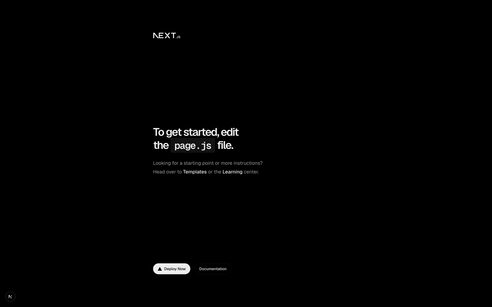
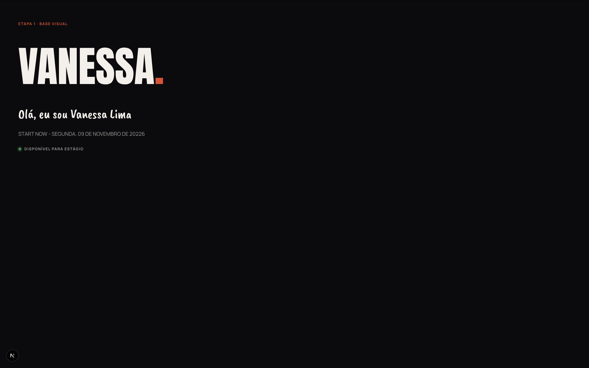
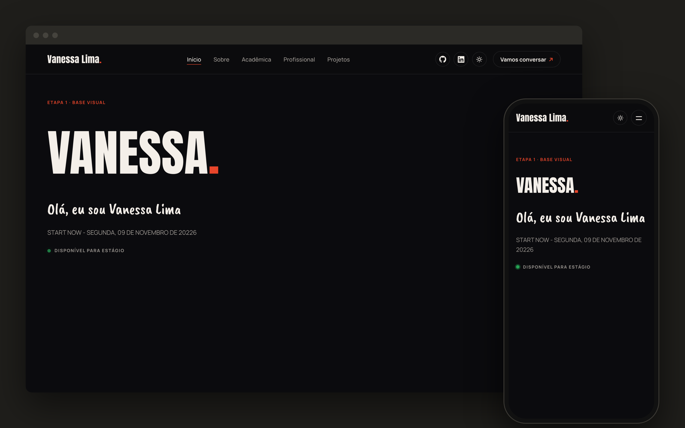
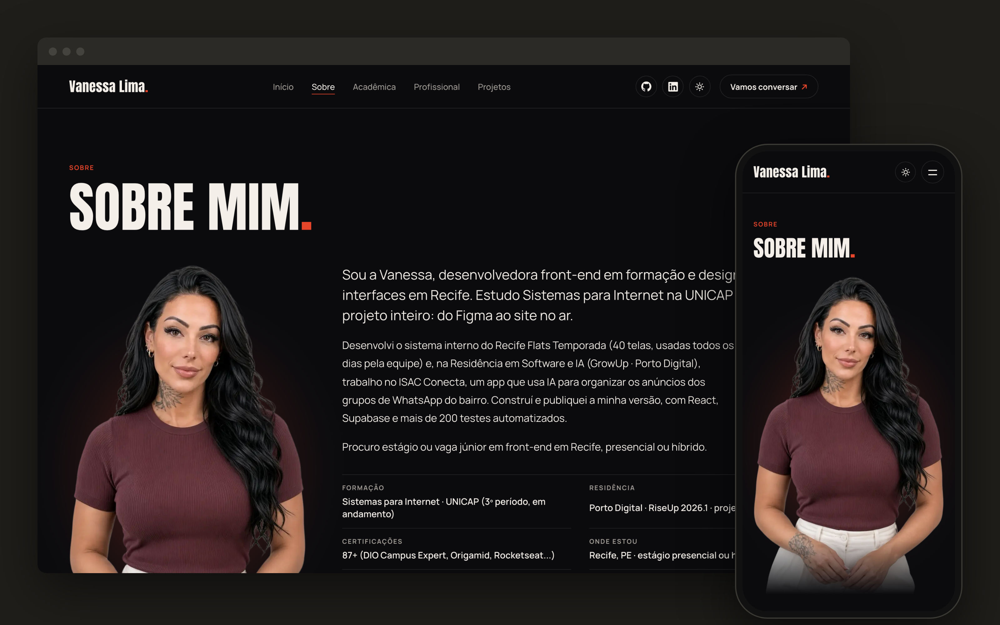
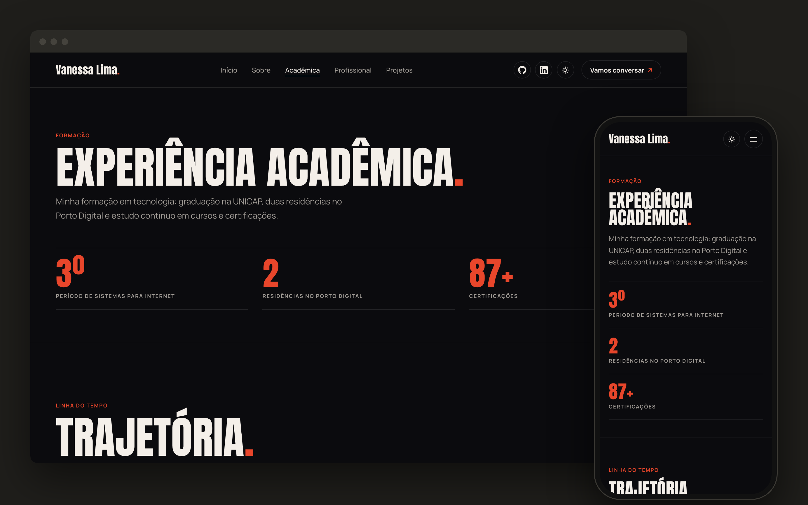
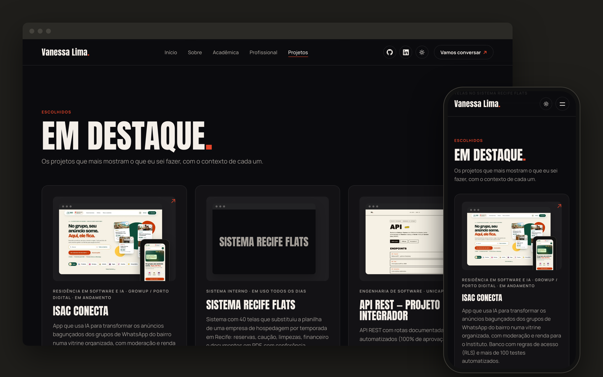
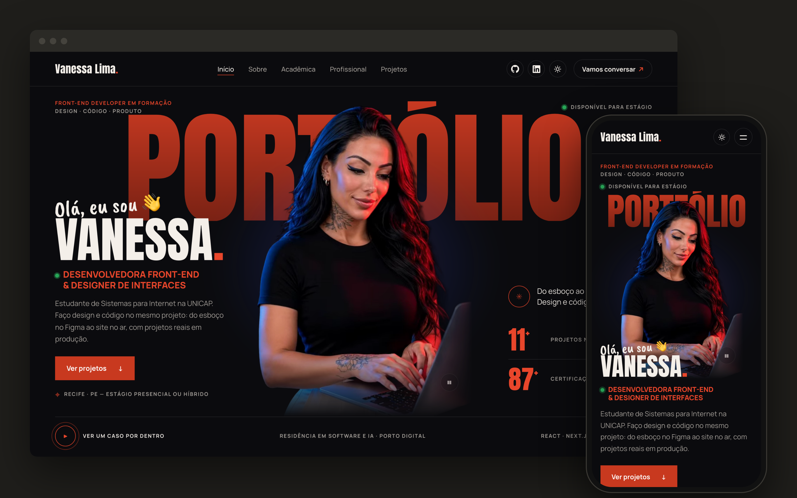
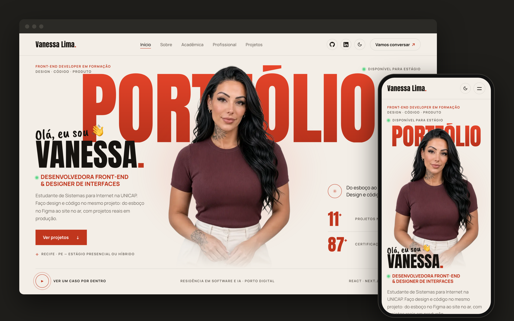

# Diário do projeto

Registro de cada etapa da construção do meu portfólio, do zero ao site no ar.

---

## Etapa 0 — Projeto criado (10/11/2026)

Criei o projeto com o comando oficial do Next.js (`create-next-app`), em JavaScript, com App Router e ESLint.

---npm

## Etapa 1 — Base visual (10/11/2026)

**O que fiz:** cores do tema escuro e claro, as 3 fontes do site (Anton, Caveat Brush e Manrope) e o script que evita a tela "piscar" ao trocar de tema.

**O que aprendi:**

- Variáveis CSS: escrevo a cor uma vez e uso no site inteiro.
- O `layout.jsx` é a moldura de todas as páginas.
- O `next/font` carrega as fontes sem o texto "pular".

---

## Etapa 2 — Navbar e tema (10/11/2026)

**O que fiz:** barra de navegação fixa com efeito vidro, links do menu, ícones do GitHub e LinkedIn, botão de tema claro/escuro que lembra a escolha, menu hambúrguer no celular e páginas provisórias.

**O que aprendi:**

- Componentes: separei a Navbar em pedaços pequenos (LinksRedes, BotaoTema, BotaoConversar).
- `"use client"`: é preciso quando o componente tem clique ou estado.
- `useState` guarda se o menu está aberto; `useEffect` trava a rolagem e escuta a tecla Esc.
- Segurança: links externos com `rel="noopener noreferrer"`.

---

## Etapa 3 — Página Sobre (12/11/2026)

**O que fiz:** a página `/sobre` de verdade, no lugar do "Em construção": minha foto, bio, resumo rápido, habilidades e a seção "Tecnologias e módulos usados neste app", com o papel de cada tecnologia e a versão lida do `package.json`. Também escrevi como este site foi feito, em 6 passos.

**O que aprendi:**

- `next/image`: carrega a foto no tamanho certo para cada tela e em formato leve (AVIF/WebP).
- Separar conteúdo e layout: os textos ficam em `data/sobre.js`, e a página só os mostra.
- Um teste que protege a lista: se eu instalar um pacote novo e esquecer de explicá-lo na página, o `npm test` falha.
- JSON-LD `ProfilePage`: um texto escondido na página que diz ao Google que ela é o meu perfil.
- HTML com significado: `<dl>` para pares rótulo/valor e `<ol>` para passos em ordem.
- Segurança: links externos com `rel="noopener noreferrer"` e `<` trocado por `\u003c` no JSON-LD, para ninguém fechar a tag `</script>`.

---

## Etapa 4 — Experiência Acadêmica e Profissional (13/11/2026)

**O que fiz:** as páginas `/experiencia-academica` e `/experiencia-profissional`, com linha do tempo, certificações e os sites feitos para clientes. Depois corrigi os fatos: separei as **duas residências** do Porto Digital (RiseUp 2026.1, com o Miaumigo selecionado para o CoDay, e GrowUp 2026.2, com o ISAC Conecta), e o sistema da Recife Flats entrou na experiência profissional.

**O que aprendi:**

- Componentes novos reaproveitáveis: `Timeline` (linha do tempo) e `CabecalhoPagina` (título + números do topo).
- `PREENCHER`: em vez de inventar data ou cargo, o campo fica marcado, o site esconde e o `npm test` lista o que falta.
- Conteúdo também é código: um teste impediu que um link sem HTTPS entrasse nas experiências.

---

## Etapa 5 — Projetos com a API do GitHub (14/11/2026)

**O que fiz:** a página `/projetos` com duas partes: **destaques** escolhidos à mão (`data/projetos.js`) e **outros repositórios** buscados na API pública do GitHub. Cada cartão mostra os prints do projeto num **mockup de computador + celular**, e as tags de tecnologia ganharam **cor por área**, inspirada na Origamid (com brilho neon no hover).

**O que aprendi:**

- `fetch` no servidor com `"use cache"` e `cacheLife("hours")`: a API é chamada poucas vezes e a página abre rápido.
- Separar a função "pura" (`filtrarRepositorios`, testada sem internet) da que acessa a rede (`buscarRepositorios`).
- Script com Playwright (`npm run prints`) que tira os prints de cada site sozinho, inclusive esperando a API do Render "acordar".
- A moldura do mockup é CSS, não imagem: se adapta ao cartão e ao tema.
- Só entra na lista automática repositório com descrição: sem contexto, vira ruído.

---

## Etapa 6 — Página Início com a Hero em vídeo (14/11/2026)

**O que fiz:** trouxe a Hero do meu portfólio anterior (React + Vite) para o Next.js: "PORTFÓLIO" gigante aparecendo letra por letra, "Olá, eu sou" com aceno, nome com reflexo, números contando e o rodapé com o play. No **tema escuro** entra o **vídeo com fundo transparente**; no **tema claro**, a foto de blusa vinho. Abaixo, os projetos em destaque e os atalhos para as páginas, que **sobem ao rolar**.

**O que aprendi:**

- Vídeo WebM com canal alfa: o Safari não mostra a transparência, então ele recebe um WebP animado (`lib/midia.js` decide, e é testada).
- Botão de pausar: animação com mais de 5 s precisa de um jeito de parar (WCAG 2.2.2).
- O ESLint barrou `setState` dentro de `useEffect`; reescrevi com `useSyncExternalStore` e com o atributo `data-estado` no próprio elemento.
- Mostrar a imagem certa de cada tema só com CSS (`[data-tema="claro"]`), sem "piscar" ao abrir.
- `IntersectionObserver` para as seções aparecerem ao rolar, uma vez só e sem esconder o que já está na tela.

---

## Etapa 7 — Revisão: SEO, acessibilidade e Lighthouse (14/11/2026)

**O que fiz:** segui um relatório de revisão do site e conferi cada ponto no código antes de mexer. Corrigi os metadados das páginas internas, o contraste de cores e o conteúdo repetido; depois medi com o Lighthouse em modo celular, nos dois temas.

| Página       | Desempenho | Acessibilidade | Boas práticas | SEO |
| ------------ | ---------- | -------------- | ------------- | --- |
| Início       | 91–93      | 100            | 100           | 100 |
| Sobre        | 97         | 100            | 100           | 100 |
| Acadêmica    | 99         | 100            | 100           | 100 |
| Profissional | 98–99      | 100            | 100           | 100 |
| Projetos     | 95–96      | 100            | 100           | 100 |

Sem rolagem lateral em 320, 375, 768, 1024 e 1440 px.

**O que aprendi:**

- O Next junta os metadados do layout e da página de forma **rasa**: quem escreve `openGraph` na página perde a imagem do layout. Criei `lib/metadados.js` e um teste que confere as 5 páginas.
- Contraste: o vermelho `#e8462b` dava 3,4:1 no fundo creme (o mínimo é 4,5:1). No tema claro ele virou `#c0361d`, e os botões com texto branco ganharam `--cor-botao`.
- Medir mais de uma vez: a primeira nota da Início (61) era o servidor "frio" logo depois do build. Repetindo, deu 91–93.
- Nem todo relatório acerta: vários itens apontados já estavam resolvidos no código. Conferir antes de mudar.
