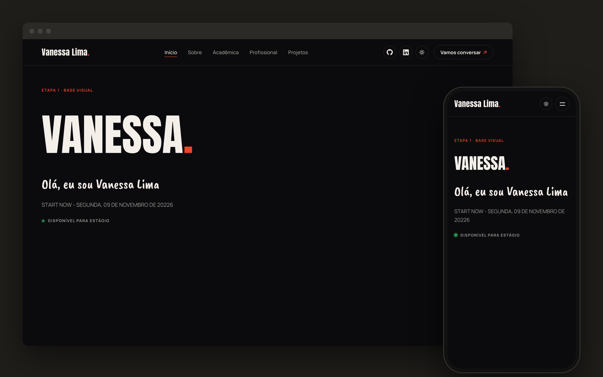
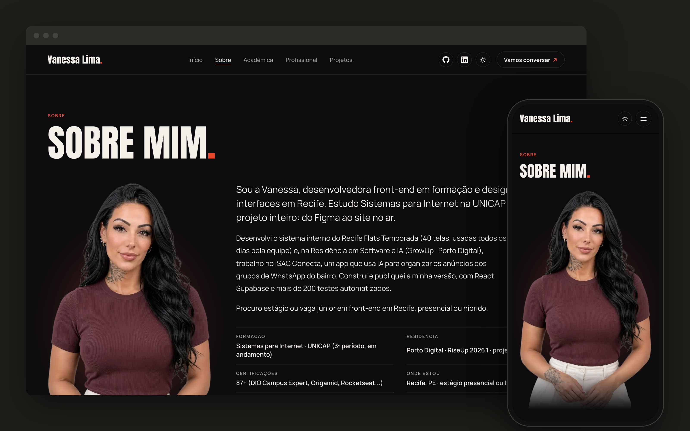

# Diário do projeto

Registro de cada etapa da construção do meu portfólio, do zero ao site no ar.

---

## Etapa 0 — Projeto criado (10/11/2026)

Criei o projeto com o comando oficial do Next.js (`create-next-app`), em JavaScript, com App Router e ESLint.

---npm

## Etapa 1 — Base visual (10/11/2026)

**O que fiz:** cores do tema escuro e claro, as 3 fontes do site (Anton, Caveat Brush e Manrope) e o script que evita a tela "piscar" ao trocar de tema.

**O que aprendi:**
- Variáveis CSS: escrevo a cor uma vez e uso no site inteiro.
- O `layout.jsx` é a moldura de todas as páginas.
- O `next/font` carrega as fontes sem o texto "pular".

---

## Etapa 2 — Navbar e tema (10/11/2026)

**O que fiz:** barra de navegação fixa com efeito vidro, links do menu, ícones do GitHub e LinkedIn, botão de tema claro/escuro que lembra a escolha, menu hambúrguer no celular e páginas provisórias.

**O que aprendi:**
- Componentes: separei a Navbar em pedaços pequenos (LinksRedes, BotaoTema, BotaoConversar).
- `"use client"`: é preciso quando o componente tem clique ou estado.
- `useState` guarda se o menu está aberto; `useEffect` trava a rolagem e escuta a tecla Esc.
- Segurança: links externos com `rel="noopener noreferrer"`.

---

## Etapa 3 — Página Sobre (12/11/2026)

**O que fiz:** a página `/sobre` de verdade, no lugar do "Em construção": minha foto, bio, resumo rápido, habilidades e a seção "Tecnologias e módulos usados neste app", com o papel de cada tecnologia e a versão lida do `package.json`. Também escrevi como este site foi feito, em 6 passos.

**O que aprendi:**
- `next/image`: carrega a foto no tamanho certo para cada tela e em formato leve (AVIF/WebP).
- Separar conteúdo e layout: os textos ficam em `data/sobre.js`, e a página só os mostra.
- Um teste que protege a lista: se eu instalar um pacote novo e esquecer de explicá-lo na página, o `npm test` falha.
- JSON-LD `ProfilePage`: um texto escondido na página que diz ao Google que ela é o meu perfil.
- HTML com significado: `<dl>` para pares rótulo/valor e `<ol>` para passos em ordem.
- Segurança: links externos com `rel="noopener noreferrer"` e `<` trocado por `\u003c` no JSON-LD, para ninguém fechar a tag `</script>`.

