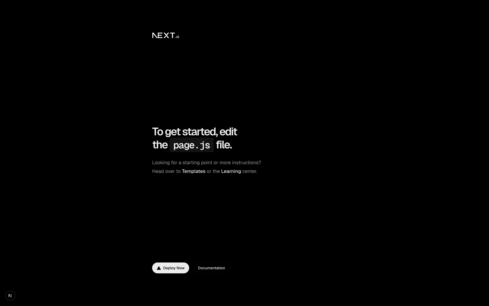
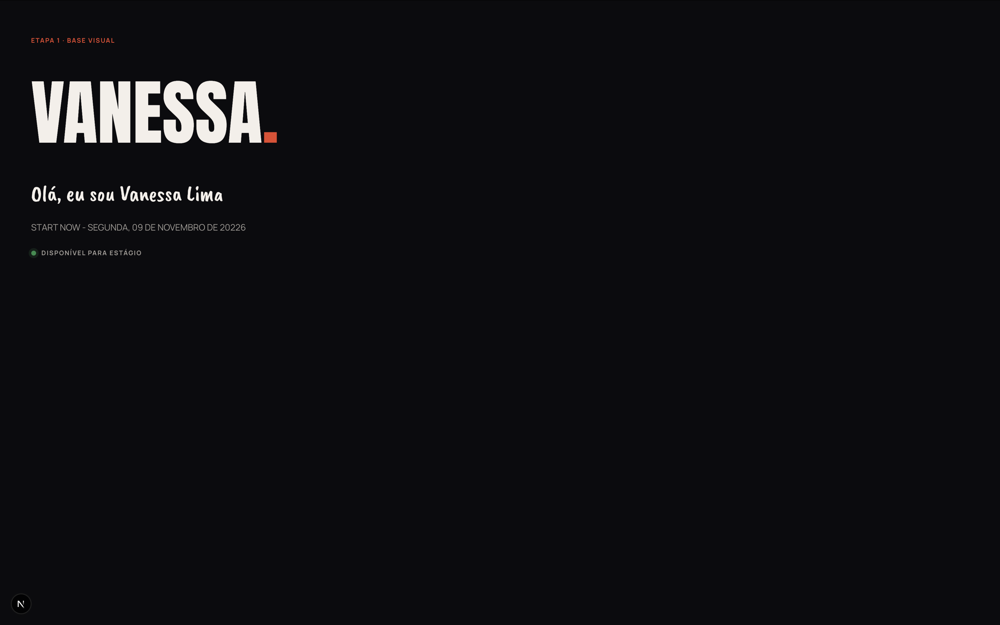

# Diário do projeto

Registro de cada etapa da construção do meu portfólio, do zero ao site no ar.

---

## Etapa 0 — Projeto criado (10/11/2026)

Criei o projeto com o comando oficial do Next.js (`create-next-app`), em JavaScript, com App Router e ESLint.

---

## Etapa 1 — Base visual (10/11/2026)

**O que fiz:** cores do tema escuro e claro, as 3 fontes do site (Anton, Caveat Brush e Manrope) e o script que evita a tela "piscar" ao trocar de tema.

**O que aprendi:**
- Variáveis CSS: escrevo a cor uma vez e uso no site inteiro.
- O `layout.jsx` é a moldura de todas as páginas.
- O `next/font` carrega as fontes sem o texto "pular".

